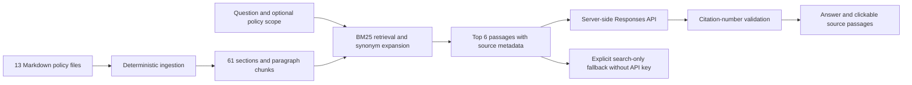

# Northstar Policy Compass

A private company-policy RAG application built with React, Vinext, and a Cloudflare Worker backend. The provided Northstar corpus is synthetic demonstration material.

## Run

Requires Node 22.13+ and npm.

```sh
npm ci
node scripts/ingest.mjs
npm run dev
```

Open the local URL printed by the development server. The production site uses Sites owner-private authentication. Do not expose the local development server to the public internet: it has no standalone authentication.

## Enable LLM generation

Configure `OPENAI_API_KEY` as a **secret** in Sites runtime environment variables and deploy again. Optionally configure `OPENAI_MODEL` (default `gpt-4.1-mini`). Do not put keys in the browser, source, or hosting manifest. For local development, provide these through the shell environment or the runtime's ignored `.dev.vars` file.

Without a key the app explicitly returns policy search results, not a fabricated AI answer. With a key, the server calls the OpenAI Responses API. API failures are shown as errors; retries are user initiated. No live-provider test is implied by the mocked tests.

Reference: https://developers.openai.com/api/docs/guides/text

## Architecture



- `corpus/`: copies of the 13 supplied Markdown files. The companion PDF is not ingested, avoiding duplicate evidence.
- `scripts/ingest.mjs`: deterministic conversion with source SHA-256, document title, metadata, stable section IDs, and exact paragraph text.
- `lib/retrieval.mjs`: in-memory BM25 ranking over paragraphs, headings, and document titles, with stop-word normalization and common workplace synonyms. No vector database or embedding service is required for this small corpus.
- `lib/answer.mjs`: bounded evidence prompt, refusal instructions for insufficient evidence, timeout, upstream error handling, `store: false`, and citation-number validation.
- `app/api/ask/route.ts`: same-origin JSON POST, question length validation, document scope validation, private/no-store responses.
- `worker/index.ts` and `lib/runtime.ts`: request-scoped secrets kept out of client bundles.
- `app/page.tsx`: question interface, policy scope, library content search, source reader, saved answers, local question history, empty/loading/error states, responsive layout, keyboard dialog handling.

Questions are independent. The application does not send conversation history to the model; follow-up questions should include their subject. Each generation sends the current question and up to six source passages to OpenAI. Saved answers and the latest 40 questions are stored in browser localStorage, not shared across users or devices. The raw answer is rendered as text, not HTML. The provider has no tools and cannot execute workplace actions.

## Update the corpus

Replace or edit Markdown files in `corpus/`, preserving `#` document titles and `##` section headings. Then run `node scripts/ingest.mjs`, tests, and redeploy. Update UI counts if the number of documents or sections changes. Metadata absent from source documents remains “Not specified”; it is not inferred. The original governance document mentions ten policies, while the supplied folder contains thirteen; source text is retained unchanged.

## Validation

```sh
node --test tests/rag.test.mjs
npx tsc --noEmit
npm run build
```

Tests cover source identity, leave qualifications, procurement approvals, remote-work synonyms, lost devices, policy scoping, unrelated questions, missing keys, provider errors, bounded evidence, and invalid citations. The provider tests use controlled mocks and do not verify model quality.

## Limits and production expansion

This is an initial working implementation for a small, fixed corpus. BM25 is lexical retrieval and can miss paraphrases. A citation check proves that the source number exists, not that each claim follows from it. The UI exposes original passages for verification. The model is instructed to surface conflicts rather than silently choose a policy.

Before a larger employee rollout, evaluate actual generated answers on an approved question set, add semantic retrieval/reranking if needed, add durable per-user history if required, and introduce application-level quotas/rate limits and operational monitoring. Sites controls access to the whole corpus; this app does not implement different document permissions for different roles. It does not support PDF uploads, OCR, runtime corpus edits, or enterprise document sync.
