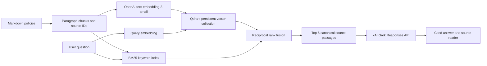

# Northstar Policy Compass

A private company-policy RAG application built with React, Vinext, and a Cloudflare Worker backend. The provided Northstar corpus is synthetic demonstration material.

## Run

Requires Node 22.13+ and npm.

```sh
npm ci
node scripts/ingest.mjs
npm run dev
```

Open the local URL printed by the development server. The production site uses Sites owner-private authentication. Do not expose the local development server to the public internet: it has no standalone authentication.

## Enable LLM generation

Answer generation defaults to xAI Grok (`LLM_PROVIDER="xai"`, `XAI_MODEL="grok-4.7"`). Create a separate xAI API key at https://console.x.ai and set `XAI_API_KEY` in the ignored `.dev.vars` file, then restart the local server. For hosting, configure the key as a **secret** in Sites runtime environment variables and redeploy. Do not put keys in the browser, source, or hosting manifest. An OpenAI key cannot authenticate with xAI.

To select OpenAI generation explicitly, set `LLM_PROVIDER="openai"`, `OPENAI_API_KEY`, and optionally `OPENAI_MODEL` (default `gpt-4.1-mini`). The two providers never share credentials.

Without a key the app explicitly returns policy search results, not a fabricated AI answer. With a key, the server calls the selected provider’s Responses API with `store=false` (120-second timeout for Grok; 45 seconds for OpenAI). API failures are shown as errors; retries are user initiated. No live-provider test is implied by the mocked tests.

Reference: https://developers.openai.com/api/docs/guides/text

## Semantic retrieval: embeddings and Qdrant

The application now combines OpenAI `text-embedding-3-small` embeddings (1,536
 dimensions) with a persistent Qdrant vector database and LangChain BM25Retriever. LangChain EnsembleRetriever merges both rankings
 using reciprocal rank fusion into up to six cited
 passages. The UI explicitly labels keyword-only fallback.

Local setup (Docker Desktop must be running):

```sh
npm run vectors:start
# Add your actual OPENAI_API_KEY to .dev.vars, then:
npm run ingest
npm run index:vectors
npm run dev
```

Local `.dev.vars` configuration (never commit actual credentials):

```env
OPENAI_API_KEY=""
OPENAI_MODEL="gpt-4.1-mini"
QDRANT_URL="http://127.0.0.1:6333"
QDRANT_API_KEY=""
SEMANTIC_SCORE_THRESHOLD="0.35"
```

The pinned Qdrant container binds only to localhost and stores its database in a
Docker named volume. `npm run vectors:stop` stops it without deleting data.
Embedding the corpus incurs API usage; indexing submits policy passages to OpenAI.
LangChain stores vectors, document content, and nested source metadata in Qdrant.
Retrieved IDs are resolved against the application's canonical corpus before
being used as answer evidence; remote text cannot override local policy text. Queries send the user's question to the
embedding API and its vector to Qdrant. Credentials remain server-side.

`npm run index:vectors` loads `.dev.vars`; shell environment variables take
precedence. It creates a collection named from a SHA-256 fingerprint of the
corpus, model, and dimensions. A complete collection is reused without new
embedding calls; a partial collection is re-upserted safely. Indexing creates a
`metadata.documentId` keyword payload index for document filtering. Serving checks vector dimensions
and the expected point count before querying. Changes to corpus content produce
a new collection; old collections are retained rather than deleted automatically.
Run indexing again after ingestion changes and before deploying that corpus.
Do not manually edit an app-managed collection.

For the hosted Site, configure an HTTPS Qdrant endpoint reachable by Cloudflare
Workers (for example, your Qdrant Cloud cluster), plus its API key, and the OpenAI
key as Sites runtime secrets. Index the same corpus against that endpoint and
redeploy. The hosted Worker cannot reach your laptop's localhost database. No
cloud database has been provisioned by this change. Use a read-only Qdrant API key
for serving if supported by your cluster; indexing requires write access.

Semantic search uses a configurable cosine score threshold (default 0.35, between
0 and 1). This is a retrieval cutoff, not calibrated confidence. Evaluate and tune
it on your own policy questions before relying on generated answers.

References:
- https://developers.openai.com/api/docs/guides/embeddings
- https://api.qdrant.tech/api-reference/search/query-points/
- https://qdrant.tech/documentation/manage-data/collections/

## LangChain migration

Embeddings, vector ingestion/search, keyword retrieval, and rank fusion now use
LangChain.js. Answer generation uses the direct xAI Responses API by default; OpenAI remains an explicit option.
There is no Python service and no LangSmith tracing configured by this app.

The LangChain payload schema differs from the previous custom implementation.
Run `npm run index:vectors` after setting OPENAI_API_KEY to build the new
`northstar_lc_...` collection. Its fingerprint includes the `langchain-v1` schema,
model, dimensions, and corpus. Legacy `northstar_...` collections are retained,
not modified or deleted. Until the new collection is complete, the application
reports keyword fallback. Existing bookmarks and citation source IDs remain valid.

Packages are locked in package-lock.json. The BM25 adapter is in
`@langchain/community`, which currently emits a package-deprecation warning;
we import only its BM25 module. Track a maintained successor before a future
major dependency upgrade. Framework compatibility is verified by the Worker
build and local runtime checks, rather than assumed from Node-only documentation.

## Architecture



- `corpus/`: copies of the 13 supplied Markdown files. The companion PDF is not ingested, avoiding duplicate evidence.
- `scripts/ingest.mjs`: deterministic conversion with source SHA-256, document title, metadata, stable section IDs, and exact paragraph text.
- `lib/retrieval.mjs`: LangChain BM25Retriever with policy token normalization, synonyms, relevance gating, and document-scope checks. Custom BM25 scoring has been removed.
- `lib/vector-store.mjs`: LangChain OpenAIEmbeddings and QdrantVectorStore; vector search runs through asRetriever().invoke(). Policy-specific subclasses validate dimensions, readiness, score cutoff, and canonical sources. Qdrant administration uses the adapter's official REST client.
- `lib/hybrid-retrieval.mjs`: LangChain EnsembleRetriever with equal weights and c=60, invoked through a BaseRetriever pipeline with request-local fallback status. Custom rank-fusion scoring has been removed.
- `scripts/index-vectors.mjs`: batched embedding and idempotent Qdrant upserts.
- `compose.yaml`: local Qdrant service with persistent storage.
- `lib/answer.mjs`: bounded evidence prompt, refusal instructions for insufficient evidence, timeout, upstream error handling, `store: false`, and citation-number validation.
- `app/api/ask/route.ts`: same-origin JSON POST, question length validation, document scope validation, private/no-store responses.
- `worker/index.ts` and `lib/runtime.ts`: request-scoped secrets kept out of client bundles.
- `app/page.tsx`: question interface, policy scope, library content search, source reader, saved answers, local question history, empty/loading/error states, responsive layout, keyboard dialog handling.

Questions are independent. The application does not send conversation history to the model; follow-up questions should include their subject. Each generation sends the current question and up to six source passages to the selected generation provider. Saved answers and the latest 40 questions are stored in browser localStorage, not shared across users or devices. The raw answer is rendered as text, not HTML. The provider has no tools and cannot execute workplace actions.

## Update the corpus

Replace or edit Markdown files in `corpus/`, preserving `#` document titles and `##` section headings. Then run `npm run ingest`, `npm run index:vectors`, tests, and redeploy. Update UI counts if the number of documents or sections changes. Metadata absent from source documents remains “Not specified”; it is not inferred. The original governance document mentions ten policies, while the supplied folder contains thirteen; source text is retained unchanged.

## Validation

```sh
npm test
npx tsc --noEmit
npm run build
```

Tests cover source identity, leave qualifications, procurement approvals, remote-work synonyms, lost devices, policy scoping, unrelated questions, missing keys, provider errors, bounded evidence, and invalid citations. The provider tests use controlled mocks and do not verify model quality.

The vector unit tests cover embedding dimensions and ordering, corpus versioning,
readiness, document filters, source validation, rank fusion, and service failures.
To test against the real local Qdrant service:

```sh
QDRANT_TEST_URL=http://127.0.0.1:6333 node --test tests/qdrant.integration.test.mjs
```

That test creates and deletes only its own unique temporary collection and uses
deterministic test vectors. It validates database integration, not model quality.
Live corpus embedding still requires a configured OpenAI API key.

## Limits and production expansion

This is an initial working implementation for a small, fixed corpus. Semantic retrieval improves paraphrase matching when configured; keyword-only fallback can still miss paraphrases. A citation check proves that the source number exists, not that each claim follows from it. The UI exposes original passages for verification. The model is instructed to surface conflicts rather than silently choose a policy.

Before a larger employee rollout, evaluate actual generated answers on an approved question set, evaluate whether additional reranking is needed, add durable per-user history if required, and introduce application-level quotas/rate limits and operational monitoring. Sites controls access to the whole corpus; this app does not implement different document permissions for different roles. It does not support PDF uploads, OCR, runtime corpus edits, or enterprise document sync.

The Grok migration is covered by mocked provider tests. Live Grok authentication and generation require a funded `XAI_API_KEY` and have not yet been verified. Embeddings remain OpenAI `text-embedding-3-small`; Grok generation can use BM25 passages when semantic indexing is unavailable.

Prompt guardrails: unsupported or outside-corpus questions receive exactly `i can only answer about our policies`. With no retrieved evidence, this response needs no API call. Answers are limited to 150 whitespace-separated words (including citations); overlong output falls back to source passages without truncating conditions. Output budgets are 1,024 tokens for Grok (including reasoning) and 512 for OpenAI. These checks bound length and citation identifiers; relevance with retrieved evidence still depends on the model following the system instructions.
